# Manual de uso, ejecución y pruebas del proyecto

## 1. Descripción

Este manual explica el procedimiento necesario para ejecutar y comprobar el funcionamiento del proyecto desarrollado para la práctica de Seguridad Informática. El entorno implementado utiliza Flask para la aplicación web y SQLite para el almacenamiento de los usuarios, además incorpora pruebas controladas de autenticación, SQL Injection, mitigación de la vulnerabilidad y escaneo de puertos.

Las pruebas se realizan únicamente sobre el equipo local mediante la dirección `127.0.0.1`, de modo que las actividades de análisis se mantienen dentro del entorno preparado para la práctica académica.

## 2. Requisitos para la ejecución

Para utilizar el proyecto se requiere disponer de los siguientes elementos:

- Python 3.
- Flask.
- Requests.
- Navegador web.
- PyCharm u otro editor compatible con Python.
- SQLite, disponible mediante el módulo incluido con Python.

Las pruebas realizadas para la integración del proyecto se ejecutaron utilizando un entorno virtual de Python desde PyCharm.

## 3. Estructura del proyecto

Los archivos se encuentran organizados dentro de la carpeta principal del proyecto de la siguiente manera:

```text
Practica seguridad sqli/
├── app_vulnerable.py
├── app_segura.py
├── ataque_sql_i.py
├── pruebas_app_segura.py
├── escaneo_red.py
├── usuarios.db
├── templates/
│   ├── inicio_sesion.html
│   └── inicio_sesion_segura.html
├── static/
│   └── estilos.css
├── evidencias/
├── MANUAL_USO.md
└── README.md
```

El archivo `app_vulnerable.py` contiene la aplicación utilizada para demostrar la vulnerabilidad, mientras que `app_segura.py` corresponde a la versión protegida después de aplicar la mitigación. El archivo `ataque_sql_i.py` automatiza las pruebas de SQL Injection sobre la versión vulnerable y `pruebas_app_segura.py` permite comprobar el comportamiento de la aplicación después de implementar la protección. Por su parte, `escaneo_red.py` permite verificar el estado de determinados puertos del equipo local.

La carpeta `templates` contiene los formularios utilizados por ambas versiones de la aplicación, `static` almacena los estilos de la interfaz y `evidencias` reúne las capturas obtenidas durante el desarrollo y las diferentes pruebas realizadas.

## 4. Instalación de dependencias

Antes de iniciar la aplicación se deben instalar las bibliotecas utilizadas por el proyecto. Desde una terminal ubicada en la carpeta principal se ejecuta:

```bash
python -m pip install flask requests
```

Flask permite ejecutar la aplicación web, mientras que Requests es utilizado por los scripts encargados de automatizar las solicitudes realizadas durante las pruebas de seguridad.

## 5. Ejecución de la aplicación vulnerable

Para iniciar el servidor se ejecuta:

```bash
python app_vulnerable.py
```

Si la aplicación inicia correctamente, Flask habilita el servicio local utilizando el puerto `5000`.

El formulario vulnerable puede abrirse en el navegador mediante:

```text
http://127.0.0.1:5000/vulnerable
```

La aplicación debe permanecer ejecutándose durante las pruebas de autenticación, SQL Injection y escaneo de red.

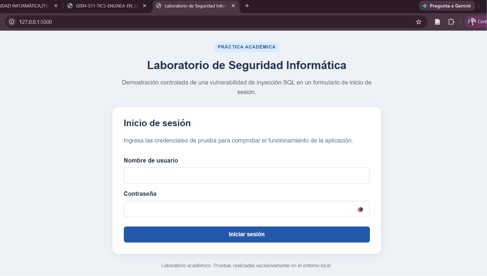

## 6. Pruebas de autenticación

### 6.1. Inicio de sesión con credenciales correctas

La primera prueba consiste en utilizar las credenciales correspondientes a un usuario registrado en la base de datos. Durante la comprobación realizada se utilizó el usuario Andrea con sus credenciales válidas.

La aplicación reconoció los datos almacenados y permitió ingresar correctamente.

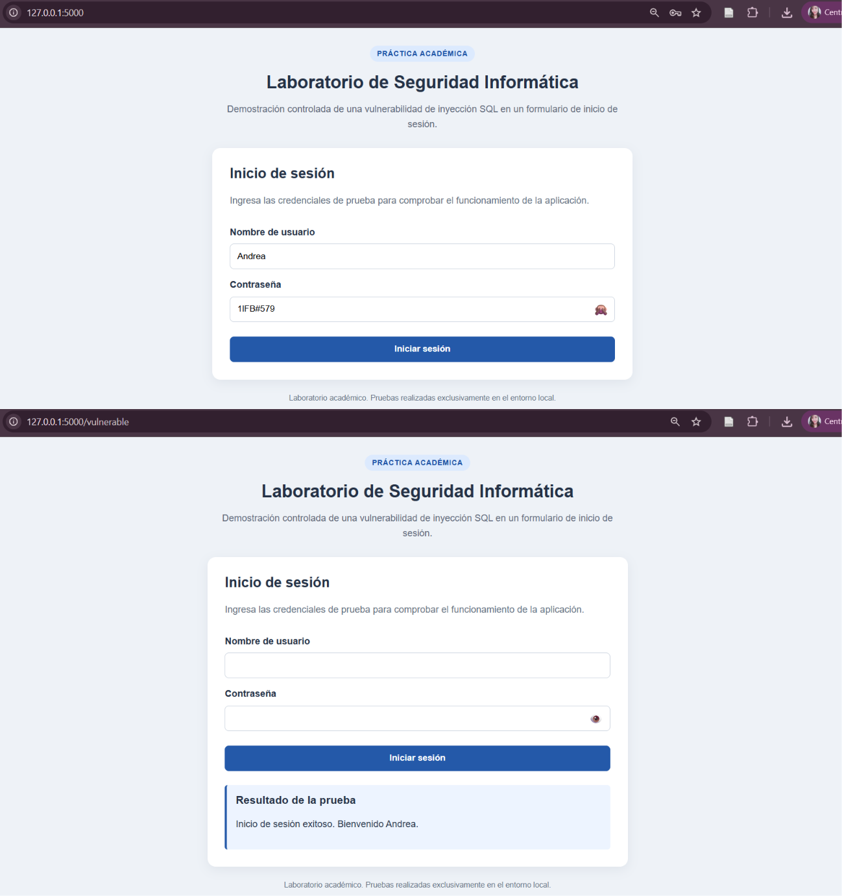

**Resultado obtenido:** acceso concedido.

### 6.2. Inicio de sesión con credenciales incorrectas

En la segunda prueba se utilizaron datos que no corresponden a una combinación válida de usuario y contraseña.

La aplicación rechazó la solicitud y no permitió el ingreso.

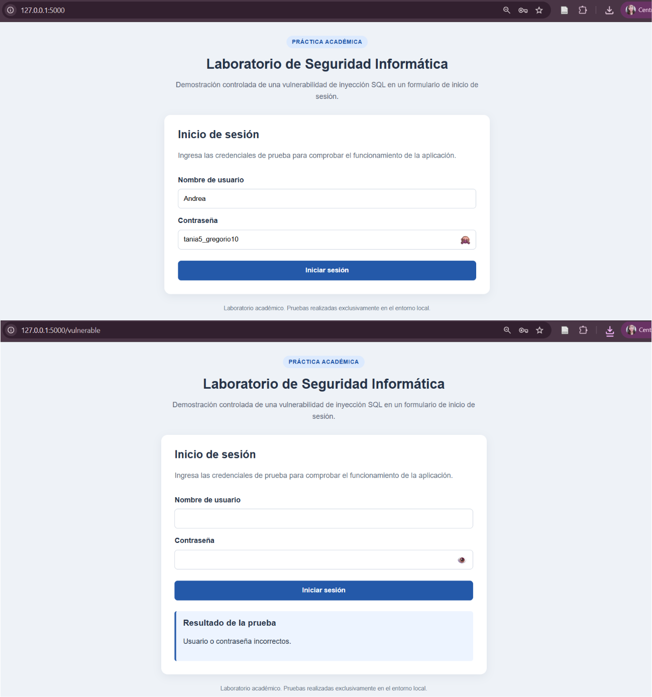

**Resultado obtenido:** acceso denegado.

### 6.3. Prueba manual de SQL Injection

Posteriormente se evaluó el formulario utilizando una entrada SQL manipulada. La prueba permitió comprobar que la consulta utilizada en la versión vulnerable podía ser modificada mediante los datos introducidos por el usuario.

Como consecuencia, fue posible superar el proceso normal de autenticación sin proporcionar una contraseña válida.

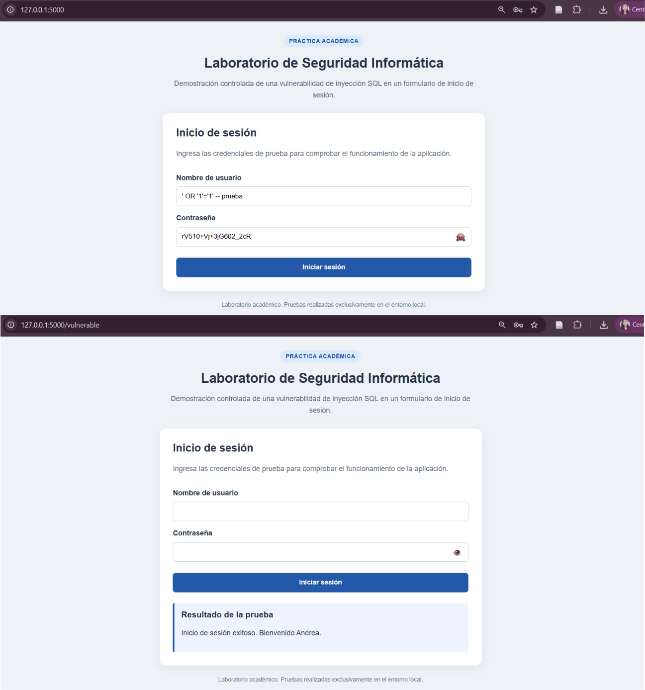

**Resultado obtenido:** acceso concedido mediante SQL Injection.

Este comportamiento confirma la vulnerabilidad existente en la versión inicial de la aplicación.

## 7. Prueba automatizada de SQL Injection

El proyecto incorpora el archivo `ataque_sql_i.py` para repetir varias pruebas de autenticación de forma automática.

Para ejecutarlo, primero debe mantenerse activo `app_vulnerable.py`. En una segunda terminal se utiliza:

```bash
python ataque_sql_i.py
```

Durante la prueba de integración se obtuvieron los siguientes resultados:

| Prueba realizada | Resultado |
|---|---|
| Credenciales incorrectas | Acceso denegado |
| SQL Injection mediante bypass | Acceso concedido |
| SQL Injection dirigido al usuario Andrea | Acceso concedido |

La primera prueba confirma que una combinación convencional de credenciales falsas es rechazada. Sin embargo, los dos intentos que utilizan entradas manipuladas mediante SQL Injection consiguen superar la autenticación de la aplicación vulnerable.

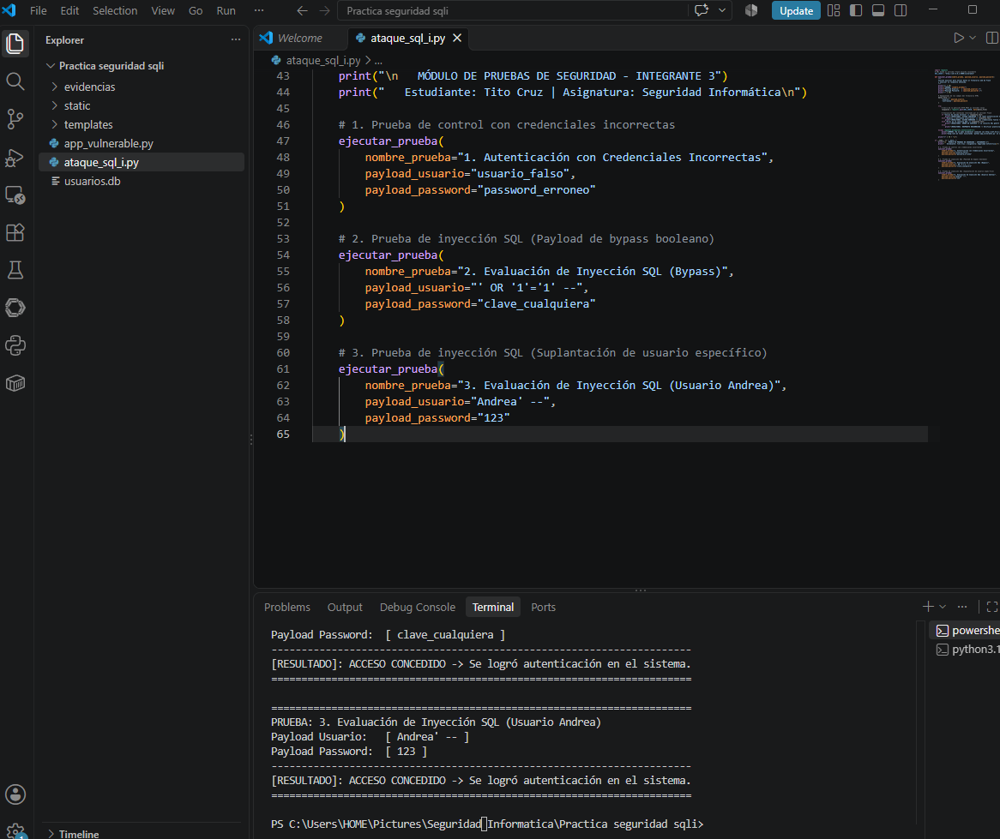

## 8. Escaneo de red

El archivo `escaneo_red.py` permite realizar una comprobación de determinados puertos sobre el propio equipo donde se encuentra ejecutándose el proyecto.

Para reproducir la prueba se mantiene activo el servidor Flask y, desde otra terminal, se ejecuta:

```bash
python escaneo_red.py -t 127.0.0.1 -p 22 80 443 3306 3389 5000
```

Los resultados obtenidos durante la integración fueron los siguientes:

| Puerto | Estado obtenido |
|---|---|
| 22 | Cerrado |
| 80 | Cerrado |
| 443 | Cerrado |
| 3306 | Cerrado |
| 3389 | Cerrado |
| 5000 | Abierto |

El puerto `5000` fue identificado como abierto debido a que corresponde al servicio Flask que se encontraba ejecutándose durante la prueba. Los demás puertos analizados se encontraron cerrados en ese momento.

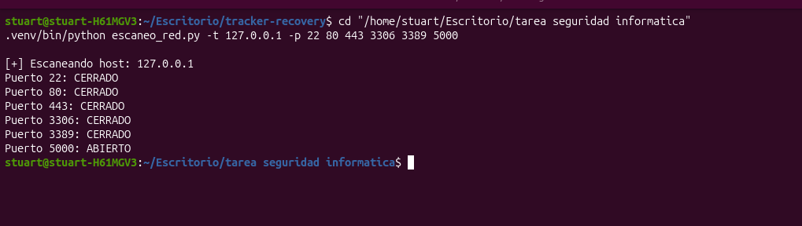

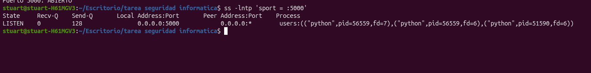

## 9. Mitigación de la vulnerabilidad

Después de comprobar el comportamiento de la aplicación vulnerable se incorporó una segunda versión mediante el archivo `app_segura.py`. Esta versión modifica la forma en que se realiza la consulta a la base de datos para evitar que los valores introducidos en el formulario sean interpretados como parte de una instrucción SQL.

La mitigación utiliza una consulta parametrizada, de modo que el nombre de usuario y la contraseña son tratados como valores independientes de la sentencia SQL. Con este cambio, las entradas manipuladas utilizadas anteriormente para alterar la consulta dejan de modificar su estructura.

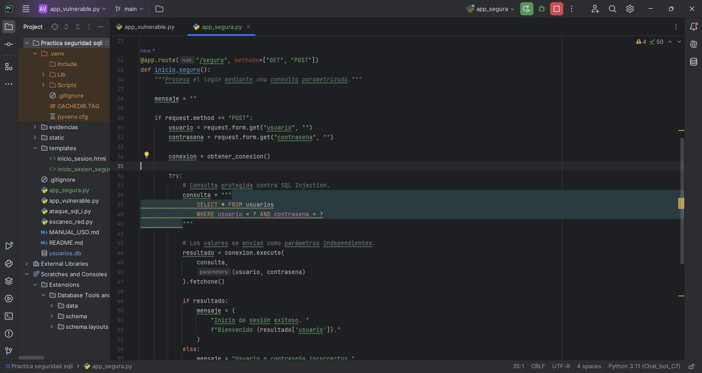

Para iniciar la versión protegida se ejecuta desde la carpeta principal:

```bash
python app_segura.py
```

El servidor Flask correspondiente a esta versión se ejecuta localmente mediante el puerto `5001`. Una vez iniciado, el formulario puede abrirse en el navegador mediante:

```text
http://127.0.0.1:5001
```

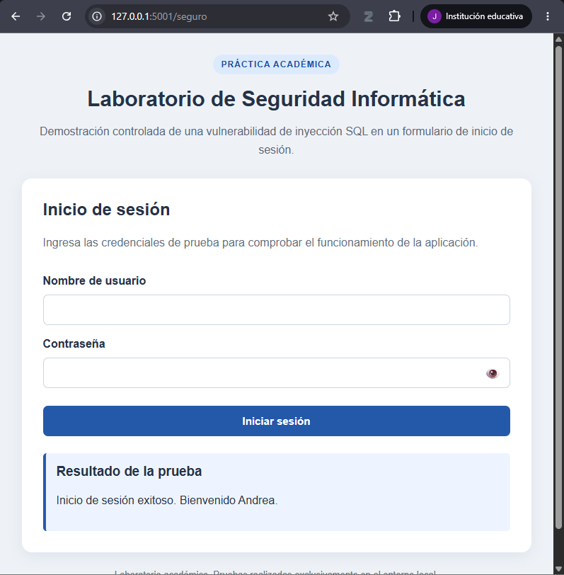

Para comprobar la mitigación también se incorporó el archivo `pruebas_app_segura.py`. Mientras `app_segura.py` permanece en ejecución, desde una segunda terminal se utiliza:

```bash
python pruebas_app_segura.py
```

La prueba automatizada comprobó cinco situaciones diferentes. El acceso mediante credenciales válidas fue permitido, mientras que una contraseña incorrecta fue rechazada. También se probaron tres intentos relacionados con SQL Injection: bypass mediante `OR 1=1`, omisión de contraseña e inyección introducida en el campo de contraseña. Los tres intentos fueron rechazados por la versión protegida.

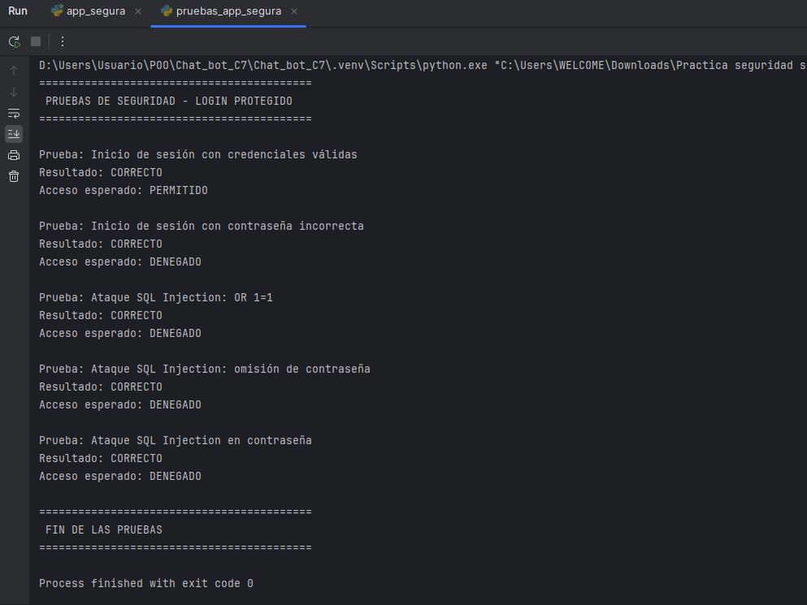

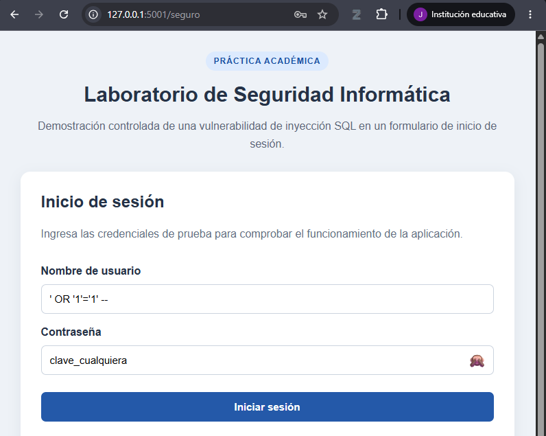

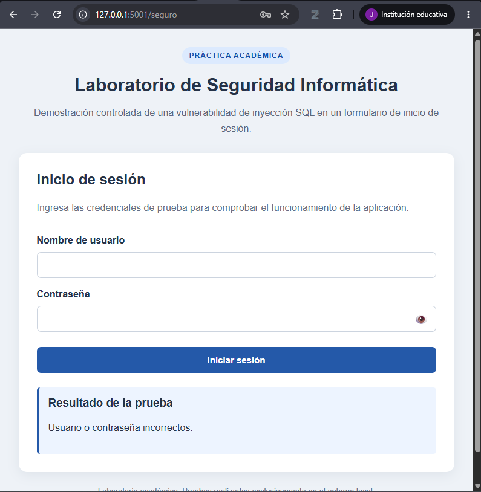

**Resultado obtenido:** la aplicación mantiene el acceso normal cuando las credenciales son válidas, pero los intentos de SQL Injection utilizados durante las pruebas no consiguen superar la autenticación.

## 10. Comparación de resultados

Las pruebas realizadas antes y después de aplicar la mitigación permiten observar el cambio producido en el mecanismo de autenticación.

| Prueba | Versión vulnerable | Versión protegida |
|---|---|---|
| Credenciales válidas | Acceso concedido | Acceso concedido |
| Credenciales incorrectas | Acceso denegado | Acceso denegado |
| SQL Injection mediante bypass | Acceso concedido | Acceso denegado |
| SQL Injection para omitir la contraseña | Vulnerable al bypass | Acceso denegado |
| SQL Injection introducida en la contraseña | Vulnerable a entradas manipuladas | Acceso denegado |

La comparación muestra que la aplicación continúa permitiendo el ingreso cuando se utilizan credenciales correctas y mantiene el rechazo de las credenciales convencionales incorrectas. La diferencia se encuentra en los intentos de SQL Injection: mientras la versión inicial permitió alterar el proceso normal de autenticación, las entradas manipuladas utilizadas durante las pruebas fueron rechazadas después de aplicar la consulta parametrizada.

Los resultados obtenidos permiten comprobar que la medida implementada corrige la vulnerabilidad demostrada en el entorno de prueba y evita que las entradas SQL utilizadas durante la práctica sean interpretadas como parte de la consulta de autenticación.

## 11. Finalización del servidor

Cuando hayan concluido las pruebas, el servidor Flask puede detenerse desde la terminal donde se encuentra ejecutándose mediante:

```text
Ctrl + C
```

Al realizar esta acción se detiene la aplicación local y se libera el puerto utilizado por el servidor Flask, correspondiente al `5000` en la versión vulnerable o al `5001` en la versión protegida.

## 12. Consideraciones de uso

Los archivos y pruebas incluidos en este proyecto fueron preparados exclusivamente para una práctica académica de Seguridad Informática. Tanto las pruebas de SQL Injection como el escaneo de puertos se realizan sobre `127.0.0.1`, que corresponde al mismo equipo donde se ejecuta la aplicación.

El propósito de estos procedimientos es observar de forma controlada cómo una vulnerabilidad puede afectar un mecanismo de autenticación, comprobar sus resultados y posteriormente verificar si la medida de mitigación aplicada consigue impedir el mismo comportamiento.